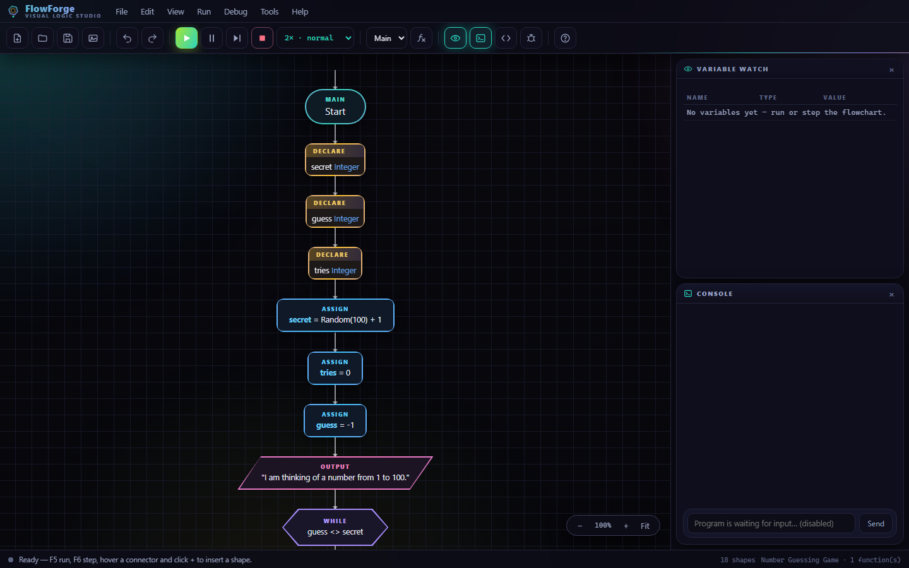

# FlowForge

**Editor flowchart, interpreter, dan debugger yang berjalan penuh di browser — tanpa build, tanpa dependensi, tanpa server.**

<p align="center">
  
</p>

<p align="center">
  <a href="https://flowgorithm.ziqintzy.my.id/"><strong>Coba live →</strong></a>
</p>

<details>
<summary>Tangkapan layar PNG (untuk pembaca yang gambarnya tidak merender SVG)</summary>
<p align="center"></p>
</details>


FlowForge meniru **cara kerja dan cara terasa** Flowgorithm: kamu menyusun diagram alir, menekan F5,
lalu melihat eksekusinya bergerak bentuk demi bentuk sambil nilai variabel berubah di Variable Watch.
Seluruh kode sumbernya ditulis ulang dari nol di tiga berkas JavaScript — tidak ada satu baris pun,
ikon, atau aset yang diambil dari Flowgorithm.

---

## Daftar isi

- [Kenapa ada proyek ini](#kenapa-ada-proyek-ini)
- [Fitur](#fitur)
- [Menjalankan](#menjalankan)
- [Cara kerja](#cara-kerja)
- [Paritas semantik dengan Flowgorithm](#paritas-semantik-dengan-flowgorithm)
- [Bentuk diagram](#bentuk-diagram)
- [Pintasan papan ketik](#pintasan-papan-ketik)
- [Format berkas .fprg](#format-berkas-fprg)
- [Tema](#tema)
- [Deploy sendiri](#deploy-sendiri)
- [Batasan yang jujur](#batasan-yang-jujur)
- [Catatan soal Flowgorithm](#catatan-soal-flowgorithm)
- [Lisensi](#lisensi)
- [Penulis](#penulis)

---

## Kenapa ada proyek ini

Flowgorithm adalah aplikasi desktop: untuk dipakai di lab komputer sekolah, ia harus dipasang.
FlowForge menjawab kebutuhan yang sama di tempat yang tidak bisa memasang apa-apa — Chromebook,
tablet, laptop orang lain, atau sesi belajar singkat di HP. Semua yang dibutuhkan cuma satu tab.

Ia sengaja tidak dibuat sebagai "flowchart cantik yang tidak bisa dijalankan". Diagram di FlowForge
benar-benar dieksekusi oleh interpreter di `js/interp.js`, lengkap dengan error runtime bertipe,
input yang menunggu diketik, dan stack frame untuk fungsi bersarang.

## Fitur

| | |
|---|---|
| **Interpreter nyata** | Bukan simulasi animasi. Ekspresi di-parse dengan shunting-yard, punya presedensi, tipe, dan error runtime yang dinamai seperti aslinya (`+ needs a number, got String`, `Concatenation needs a String, got Real`). |
| **Debugger lengkap** | Run (F5), single-step (F6), pause/resume (F7), stop (F8), breakpoint bersyarat, dan kontrol kecepatan langkah. Bentuk yang sedang dieksekusi menyala, kawat yang sedang dilalui berdenyut. |
| **Variable Watch bertipe** | Integer, Real, String, Boolean, Void — tiap tipe punya warna sendiri, array satu dimensi ditampilkan dengan ellipsis bila panjang. |
| **Konsol interaktif** | `Input` benar-benar menunggu ketikan; output bergulir dengan timestamp langkah. |
| **Turtle Graphics** | Jendela kanvas turtle (F11) untuk menggambar dengan perintah maju, belok, dan pena. |
| **Generator kode 19 bahasa** | Satu diagram → Pseudocode, Python 3, JavaScript, TypeScript, Java, C++, C#, VB.NET, VBA, Pascal, Kotlin, Swift, PHP, Perl, Ruby, Lua, Nim, Bash, PowerShell. |
| **Ekspor gambar** | Unduh diagram sebagai SVG vektor atau PNG raster. |
| **Berkas .fprg dua arah** | Buka dan simpan XML layout `.fprg`, jadi diagram bisa dipindah bolak-balik. |
| **Multi-fungsi** | Function manager dengan parameter by-value/by-reference dan nilai kembali; tiap fungsi punya kanvas sendiri. |
| **Undo/redo & papan klip** | `Ctrl+Z` / `Ctrl+Y`, salin-tempel bentuk, sisip bentuk di tengah kawat cukup dengan hover. |
| **Autosave lokal** | Dokumen terakhir disimpan di `localStorage`, jadi tidak hilang saat tab tertutup. |
| **Ramah layar sentuh** | Di HP, toolbar memuat hanya tombol yang benar-benar dipakai (sisanya tetap ada di menu), jendela berpindah lewat geseran, tombol `+` selalu terlihat, dan diagram otomatis di-zoom agar muat selebar layar. |
| **Nol dependensi** | Tidak ada framework, tidak ada bundler, tidak ada telemetri. Buka `index.html`, selesai. |

## Menjalankan

Tanpa apa-apa:

```
buka index.html di browser
```

Kalau mau lewat server lokal (misalnya untuk menguji header cache):

```
python -m http.server 8080
# lalu buka http://localhost:8080/
```

Tidak ada langkah instalasi, tidak ada `npm install`, tidak ada kompilasi.

## Cara kerja

```
index.html      struktur UI, tema CSS, jendela editor/debugger
js/interp.js    model data program, parser ekspresi, mesin eksekusi & tipe
js/codegen.js   19 template bahasa: ekspresi → AST → sumber teks
js/app.js       kanvas, debugger, watch, konsol, turtle, file I/O, undo
_headers        aturan Cache-Control untuk Cloudflare Pages
```

- **`interp.js`** menyimpan program sebagai pohon bentuk (`children` per segmen, misalnya `then`/`els`
  pada If, `body` pada loop). Ekspresi disimpan sebagai RPN hasil shunting-yard; saat dieksekusi,
  tiap operator punya aturan koersi tipe sendiri.
- **`codegen.js`** mengubah RPN kembali ke AST, lalu menuliskannya dengan tabel operator, tabel tipe,
  dan templat blok per bahasa. Bahasa yang indentatif (Python) dan yang kurung-kurawal (C-family)
  memakai jalur cetak yang sama.
- **`app.js`** merender kanvas sebagai DOM, bukan `<canvas>` — makanya bentuk bisa diklik, ditimpa,
  dan disorot per langkah tanpa gambar ulang bitmap.

## Paritas semantik dengan Flowgorithm

Aturan-aturan ini diambil dari dokumentasi resmi Flowgorithm, lalu diuji ulang dengan program sekolah
nyata. Yang paling sering salah ditebak oleh klon lain:

| Aturan | Perilaku di FlowForge |
|---|---|
| Presedensi | unary `- ! not` > `^` > `* / % mod` > `+ -` > `&` > relasional > `and` > `or` |
| Pembagian | selalu floating-point: `10 / 4` → `2.5`, bukan `2` |
| Pangkat | `^` mengikat lebih erat dari tanda minus unary: `-2 ^ 2` → `4` |
| `&` (concatenation) | menerima Integer/Real dan mengonversinya otomatis; menolak Boolean dengan error |
| Assign ke Integer | memotong diam-diam: `3.7` masuk ke Integer menjadi `3` |
| `and` / `or` / `not` | Boolean ketat; tipe lain memunculkan error, tidak dianggap benar-salah diam-diam |
| `mod` | mengikuti aritmetika Flowgorithm, error bila pembagi nol |

## Bentuk diagram

`Start` dan `End` sudah ada; 11 bentuk bisa disisipkan:

| Bentuk | Fungsi |
|---|---|
| Declare | variabel bertipe atau array satu dimensi |
| Assign | `variabel = ekspresi` |
| Input / Output | baca / tulis konsol |
| If | cabang True (kanan) dan False (kiri) yang bertemu di lingkaran merge |
| While / Do | prauji / pascauji |
| For | pencacah Integer dari–sampai–langkah; cabang Done berjalan setelah loop |
| Call | memanggil fungsi, parameter by-value/by-reference, bisa menyimpan nilai kembali |
| Comment / Breakpoint | catatan / titik henti dengan kondisi Boolean opsional |

## Pintasan papan ketik

| Tombol | Aksi |
|---|---|
| `F1` | Bantuan & pintasan |
| `F5` / `F6` / `F7` / `F8` | Run / step / pause / stop |
| `F9` `F10` `F11` `F12` | Variable Watch / Konsol / Turtle / Source Code |
| `Ctrl+N` `Ctrl+O` `Ctrl+S` | Baru / buka `.fprg` / simpan `.fprg` |
| `Ctrl+Z` `Ctrl+Y` | Undo / redo |
| `Ctrl+C` `Ctrl+V` | Salin / tempel bentuk terpilih |
| `Del` | Hapus bentuk terpilih |
| `B` | Pasang/lepas breakpoint |
| `Ctrl+scroll` | Zoom kanvas |
| `Esc` | Tutup menu, popup, dialog |

Di kanan-bawah kanvas ada pil zoom dengan tombol **Fit**: sekali klik menyesuaikan zoom supaya seluruh
lebar diagram masuk jendela (di layar sempit ini juga berjalan otomatis setiap kali diagram berubah).

Dua gerakan yang tidak ada di aplikasi desktop, tapi sangat membantu di browser: **hover sebuah kawat
lalu klik `+`** untuk menyisip bentuk di tengah alur, dan **klik-ganda bentuk** untuk mengubahnya.

## Format berkas .fprg

`.fprg` adalah XML terbuka. FlowForge membacanya dan menulisnya kembali dengan struktur atribut,
fungsi, dan bentuk yang sama, jadi diagram bisa dipindah bolak-balik antara FlowForge dan Flowgorithm
desktop. Yang tidak dibawa serta: preferensi jendela, riwayat undo, dan gambar kustom.

`examples/penjurusan.fprg` adalah contoh dunia nyata (program penjurusan SMA dengan Boolean yang
dibangun dari perbandingan `>=` yang disambung `or`/`and`) — muat lewat menu **File → Open .fprg**
untuk menguji jalur impor secara langsung.

## Tema

Empat tema, semuanya punya varian terang/gelap dan bisa diganti tanpa reload:

- **pastel** — terang, netral, paling mirip aplikasi desktop
- **aurora** (bawaan) — gelap dengan latar bercahaya
- **ember** — gelap hangat
- **ion** — gelap biru dingin

Semua gerak (latar, denyut kawat, transisi bentuk) bisa dimatikan lewat sakelar *motion*; saat dimatikan
atau saat sistem meminta `prefers-reduced-motion`, antarmuka langsung diam tanpa kehilangan informasi.

## Deploy sendiri

Aliran statis biasa — folder ini adalah hasil build-nya.

- **Cloudflare Pages**: kerangka `Main`, tanpa perintah build, direktori keluaran `/`. Berkas `_headers`
  sudah men-set `Cache-Control: public, max-age=0, must-revalidate` untuk `index.html`, `js/*.js`, dan CSS,
  supaya perbaikan langsung terlihat dan tidak tertahan 4 jam di edge.
- **Netlify / Vercel / GitHub Pages / nginx**: arahkan root ke folder ini. Tidak ada konfigurasi tambahan.
- **Hosting statis apa pun**: yang dibutuhkan hanya `.html`, `.js`, dan `_headers` bila platformnya mendukung.

## Batasan yang jujur

- **Bukan replika piksel.** Bentuk, warna, ikon, dan tata letak dibuat ulang dengan tema sendiri;
  yang ditiru adalah perilaku, bukan tampilan.
- **Ekspor PNG memakai `<canvas>` raster.** Diagram sangat besar bisa terpotong pada browser lama.
- **Tidak ada kolaborasi waktu nyata** dan tidak ada penyimpanan awan; autosave hanya di perangkat.
- **Tidak ada berpindah halaman / sub-diagram multi-bingkai** seperti pada beberapa aplikasi flowchart.
- **Bahasa target dicetak, bukan diuji kompilatornya.** Temukan kode hasil yang kurang idiomatik di
  salah satu dari 19 bahasa? Buka issue — itu bug, bukan fitur.

## Catatan soal Flowgorithm

Flowgorithm adalah perangkat lunak berpemilik milik Michael Raine dan Flowgorithm.com. Proyek ini
**tidak** dibuat dari kode sumber, ikon, bunyi, atau aset Flowgorithm, dan tidak berafiliasi dengannya.
Nama "Flowgorithm" disebut di sini hanya untuk menjelaskan perilaku mana yang jadi acuan. Kalau kamu
memang butuh aplikasi desktop-nya, gunakan yang asli: <https://www.flowgorithm.org/>.

## Lisensi

MIT — lihat [LICENSE](LICENSE). Boleh dipakai, diubah, dan diajarkan di kelas; cantumkan sumbernya.

## Penulis

**Ahmad Roziqin** — [portofolio](https://portofolio.ziqintzy.my.id/) ·
[GitHub](https://github.com/ziqinsip-png) · [live app](https://flowgorithm.ziqintzy.my.id/)
